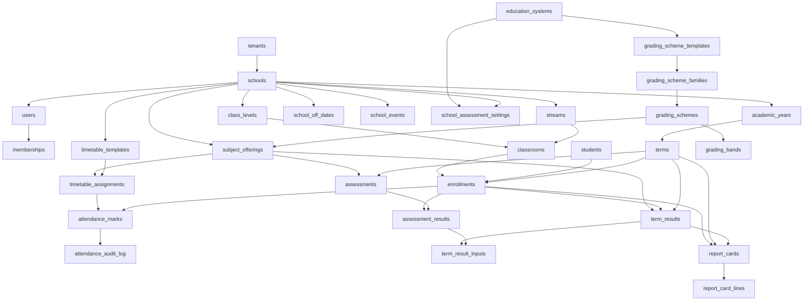

# Master Schema Inventory

This document is the single source of truth for the school management system schema. It lists all tables, their purpose, status, and owning feature/spec. Status follows the document-led workflow: `approved`, `draft`, `planned`.

## Naming & conventions
* PK = `uuidv7()` default
* `created_at`, `updated_at` timestamptz, `deleted_at` timestamptz soft delete
* All multi-tenant tables have RLS + tenant isolation
* Money is `bigint` minor units KES
* Dates are `date`, timestamps are UTC, UI uses Africa/Nairobi

## Core tenancy & organisation
| Table | Purpose | Status | Spec |
|-------|---------|--------|------|
| tenants | Tenant boundary | approved | ADR-0001 |
| schools | School per tenant | approved | PRODUCT-BRIEF |
| users | Identity | approved | ADR-0002 |
| memberships | User + School + Role | approved | DOMAIN-MODEL |
| academic_years | School year | draft | DOMAIN-MODEL |
| terms | Terms within academic year | draft | DOMAIN-MODEL |
| class_levels | PP1..Grade9 | draft | DOMAIN-MODEL |
| streams | Color/group per school | draft | DOMAIN-MODEL |
| classrooms | School + ClassLevel + Stream | draft | DOMAIN-MODEL |
| students | Pupil lifecycle | draft | DOMAIN-MODEL |
| enrollments | Student + Classroom + Term | draft | DOMAIN-MODEL |

## School calendar & timetable
| Table | Purpose | Status | Spec |
|-------|---------|--------|------|
| school_off_dates | School-wide off dates | draft | DOMAIN-MODELDATES-EVENTS-001 |
| school_events | Per-day events, affects attendance | draft | DOMAIN-MODELDATES-EVENTS-001 |
| school_event_students | Event ↔ student link | draft | DOMAIN-MODELDATES-EVENTS-001 |
| school_event_teachers | Event ↔ teacher link | draft | DOMAIN-MODELDATES-EVENTS-001 |
| timetable_templates | Master timeslot template per school | draft | DOMAIN-MODEL |
| timetable_assignments | Lesson assignment per classroom/term | draft | DOMAIN-MODEL |
| subject_offerings | Subject taught in classroom per academic year with teacher | draft | DOMAIN-MODEL / DOMAIN-MODEL |

## Attendance – per period
| Table | Purpose | Status | Spec |
|-------|---------|--------|------|
| attendance_marks | Per period attendance per enrollment | draft | DOMAIN-MODEL |
| attendance_audit_log | Audit edits after day close | draft | DOMAIN-MODEL |

## Assessment & reporting
| Table | Purpose | Status | Spec |
|-------|---------|--------|------|
| education_systems | Global education system definition | approved | DOMAIN-MODEL |
| school_assessment_settings | Per-school assessment config | draft | DOMAIN-MODEL |
| grading_scheme_templates | Global read-only templates | draft | DOMAIN-MODEL |
| grading_scheme_template_bands | Bands for templates | draft | DOMAIN-MODEL |
| grading_scheme_families | Tenant-scoped family grouping | draft | DOMAIN-MODEL |
| grading_schemes | Versioned working copies | draft | DOMAIN-MODEL |
| grading_bands | Bands within scheme | draft | DOMAIN-MODEL |
| assessments | Marked activity per subject offering | draft | DOMAIN-MODEL |
| assessment_results | Result per enrollment per assessment | draft | DOMAIN-MODEL |
| computation_policies | Term result computation policy | draft | DOMAIN-MODEL |
| term_results | Computed term result | draft | DOMAIN-MODEL |
| term_result_inputs | Explainability rows | draft | DOMAIN-MODEL |
| report_cards | Report card lifecycle | draft | DOMAIN-MODEL |
| report_card_lines | Snapshot lines at publication | draft | DOMAIN-MODEL |

## Welfare
| Table | Purpose | Status | Spec |
|-------|---------|--------|------|
| health_records | Health data | planned | DOMAIN-MODEL |
| vaccinations | Vaccination records | planned | DOMAIN-MODEL |
| behavior_records | Behavior incidents | planned | DOMAIN-MODEL |

## System & operational
| Table | Purpose | Status | Spec |
|-------|---------|--------|------|
| invites | Staff/guardian invites | draft | DOMAIN-MODEL |
| needs_attention | System generated tasks | draft | DOMAIN-MODEL |
| pending_onboarding | Stytch B2B onboarding state | approved | ADR-0002 |
| app_sessions | Opaque session tokens | approved | ADR-0002 |
| audit_logs | Immutable audit trail | draft | DOMAIN-MODEL |

## Notes
* Tables marked `draft` belong to features with status draft. Do not create migrations until feature is approved.
* `approved` tables are safe to migrate.
* `planned` tables have domain mention but no feature spec yet. Spec must be written before migration.
* Attendance is per-period per DOMAIN-MODEL. School calendar is covered by `school_off_dates` + `school_events`.
* Class teacher assignment is covered by `subject_offerings.teacher_id` and timetable.

## Dependency order

Last updated: 2025-12-05
